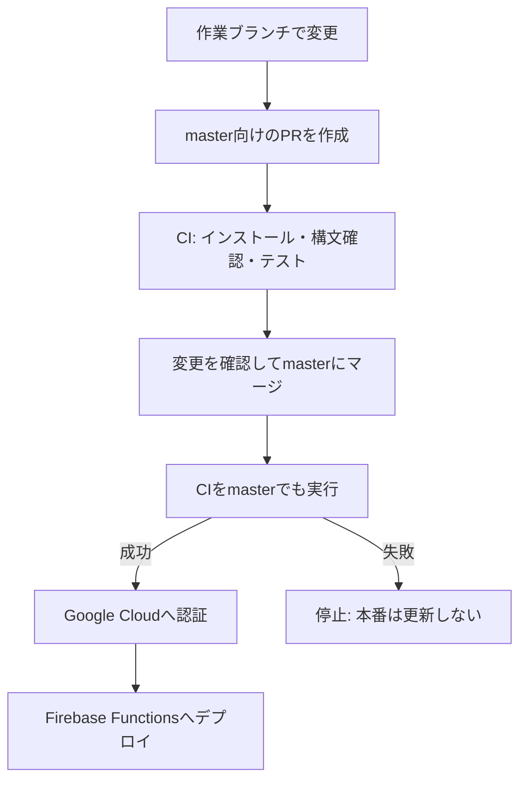

# このBotのCI/CD

## 何を自動化するのか

手元で修正しただけでは、本番のBotは変わりません。変更を確認し、Firebaseへデプロイする必要があります。
この2つをGitHub Actionsで自動化します。

- **CI (Continuous Integration / 継続的インテグレーション)**: 変更のたびにコードを確認する。今回は依存関係のインストール、JavaScriptの構文確認、通知文のテスト。
- **CD (Continuous Deployment / 継続的デプロイ)**: CIに合格した本番ブランチのコードを、自動で本番へ反映する。
- **GitHub Actions**: リポジトリ内のYAMLに書いた手順を、GitHubの実行環境で動かすサービス。

CDは手動承認を挟む「継続的デリバリー」を指すこともあります。このリポジトリでは、masterへの反映を本番反映の判断とする自動デプロイです。

## 今回の流れ



PRはPull Requestの略で、変更内容を確認してからmasterに取り込むための画面です。
PR時はテストだけが動き、本番には触りません。masterへ直接pushした場合もCI→CDが実行されます。
ブランチ保護によるマージの強制制限は今回の最小構成に含めていません。

## Actionsの基本用語とYAMLの読み方

実装は [`.github/workflows/ci-cd.yml`](../.github/workflows/ci-cd.yml) の1ファイルです。

| 設定 | 意味 | 今回の値・動き |
|---|---|---|
| workflow | 一連の自動処理 | `CI/CD` |
| `on` | いつ動かすか | master向けPR、masterへのpush、手動実行 |
| job | ひとまとまりの作業 | `test` と `deploy` |
| `runs-on` | 作業を動かすマシン | `ubuntu-latest`。GitHubが用意する一時的なLinux環境 |
| step | job内の個々の手順 | コード取得、Node準備、テストなど |
| `uses` | 公開されているActionを利用する | `actions/checkout` など |
| `run` | シェルコマンドを実行する | `npm test --prefix functions` など |
| `needs: test` | 前のjobの成功を待つ | テストに失敗したらデプロイを実行しない |
| `if` | 実行する条件を絞る | PRを除外し、masterだけデプロイする |
| `permissions` | GitHub側の実行権限 | コード読み取り。デプロイjobだけOIDCトークンの発行も許可 |
| `concurrency` | 同時実行を制御する | デプロイを同時に走らせず、実行中のデプロイを中断しない |

jobごとに別の一時マシンで動くので、コード取得やインストールは両方のjobで行います。
YAMLの字下げにも意味があります。`steps` 以下が上から順に実行され、通常は途中で失敗すると後続stepも停止します。

## CIが確認すること

```sh
npm ci --prefix functions
npm run check --prefix functions
npm test --prefix functions
```

`--prefix functions` は、ルートから `functions/package.json` のあるアプリを対象にする指定です。
`npm ci` は `package-lock.json` の記録どおりにインストールします。`npm install` と違い、
package.jsonとlockfileが食い違っていると失敗するので、手元とCIで依存関係がずれるのを防げます。

`check` はJavaScriptの構文確認、`test` はNode.js標準テストランナーの実行です。
[テスト](../functions/test/reminder.test.js)では、次の仕様を確認しています。

- 当日は、開催リマインドと指定URLの案内が別々の2メッセージになる。
- 3日前と前日は、開催リマインドだけの1メッセージになる。
- 過去や対象外の日は通知しない。

メッセージ作成を [reminder.js](../functions/reminder.js) に分けており、LINEやFirestoreに接続せずに確認できます。
そのためテストにLINEのトークンは不要です。実際のLINE配信やFirestoreへの接続まで保証するテストではありません。

CIと本番はNode.js 22に合わせています。追加のテストフレームワークやDocker、ビルド工程は使いません。

## CDの認証

GitHubにコードがあるだけでは、Google Cloudを変更する権限はありません。
そこで、GitHub Actionsを信頼する設定をGoogle Cloud側に1度だけ作ります。

1. GitHubが「このリポジトリのmasterで実行中」という証明 (OIDCトークン) を発行する。
2. Google Cloudの **Workload Identity Federation** がその証明を確認する。
3. デプロイ専用サービスアカウントとして、一時的な認証情報を得る。
4. Firebase CLIがその認証情報を使い、Functionsをデプロイする。

サービスアカウントは、自動処理用のGoogle Cloud上のアカウントです。
認証情報は実行中に自動生成されるため、サービスアカウントのJSON秘密鍵や `FIREBASE_TOKEN` は作りません。
認証先はリポジトリID・所有者ID・masterブランチで制限し、PRから本番権限を取得できないようにします。

GitHubのSettings → Secrets and variables → Actions → **Variables** に次の2つを登録します。

| 変数 | 内容 |
|---|---|
| `GCP_WORKLOAD_IDENTITY_PROVIDER` | `projects/プロジェクト番号/locations/global/workloadIdentityPools/プール名/providers/プロバイダー名` |
| `GCP_DEPLOY_SERVICE_ACCOUNT` | デプロイ専用サービスアカウントのメールアドレス |

これらは認証先の識別子なので、SecretsではなくVariablesで管理します。
LINEのトークンとシークレットは、引き続き既存のGoogle Secret Managerで管理します。

初期設定を作り直す際は、Google Cloudで対象プロジェクトのIAMを変更できるアカウントが必要です。
専用サービスアカウント、Workload Identityのプール・プロバイダー、そのアカウントへの権限付与を行い、
上記のGitHub Variablesを登録します。通常のコード変更時に繰り返す作業ではありません。

### このプロジェクトへの初期設定案

以下は追加予定の設定です。Google Cloudへの適用は、権限範囲を確認して承認した後に行います。

| 対象 | 設定値 |
|---|---|
| Google Cloudプロジェクト | `poker-bot-d0190` (番号 `65230704772`) |
| 新規デプロイ用アカウント | `github-deploy@poker-bot-d0190.iam.gserviceaccount.com` |
| 新規Workload Identityプール / プロバイダー | `github-actions` / `github` |
| OIDCの発行元 | `https://token.actions.githubusercontent.com` |
| 信頼する所有者ID / リポジトリID | `72367261` / `1422936068` (`NaohiroKobayashi/Poker-bot`) |
| 信頼するブランチとイベント | `refs/heads/master` の `push` と `workflow_dispatch` のみ |
| 追加で有効化するAPI | `sts.googleapis.com` (一時認証情報の交換用) |

プロバイダーの条件は次のとおりです。名前を他の人が再利用した場合にも同じ権限が渡らないよう、数値IDで制限します。

```text
assertion.repository_owner_id == '72367261' &&
assertion.repository_id == '1422936068' &&
assertion.ref == 'refs/heads/master' &&
assertion.event_name in ['push', 'workflow_dispatch']
```

デプロイ用アカウントに、対象プロジェクト内で次のロールを付与する予定です。

| ロール | 用途 |
|---|---|
| `roles/cloudfunctions.admin` | Functionsの更新 |
| `roles/cloudscheduler.admin` | Functionsに付随する定期実行ジョブの更新 |
| `roles/run.admin` | 第2世代FunctionsのCloud Run設定・呼び出し権限の更新 |
| `roles/serviceusage.serviceUsageConsumer` | 有効化済みAPIの利用 |
| `roles/firebase.viewer` | Firebaseプロジェクトの設定確認 |
| `roles/secretmanager.viewer` | 既存シークレットのメタデータ確認。このロール単体では値は読めない |
| `roles/artifactregistry.reader` | ビルドイメージ保存先の確認 |

これに加え、以下の2つをリソース単位で設定します。

- デプロイ用アカウント上の `roles/iam.workloadIdentityUser`: 上記リポジトリからだけ、このアカウントとして認証できるようにする。
- 既存実行アカウント `65230704772-compute@developer.gserviceaccount.com` 上の `roles/iam.serviceAccountUser`: デプロイ用アカウントが、既存の実行・ビルドアカウントを指定できるようにする。

デプロイ用アカウントへOwnerやEditorは追加しません。ただし、管理ロールはこのプロジェクトの
Functions・Cloud Run・Schedulerを変更できる権限です。さらに既存の実行アカウントには
`roles/editor` が付いているため、デプロイしたコードはその権限で動きます。
したがってmasterへの反映は、本番コードと本番で利用するデータに影響し得る操作です。
実行アカウントの権限見直しは今回のCI/CD導入には含めません。

初期設定は継続的に残りますが、サービスアカウントの秘密鍵は作成しません。
デプロイ時に不足する権限が見つかった場合は、エラー内容を確認して必要な範囲を検討します。

## 本番反映の範囲

```sh
firebase deploy --only functions --project poker-bot-d0190 --non-interactive
```

- `--only functions`: Functionsと、Functionsに関連するスケジュールなどを更新する。
- `--project`: 対象を既存の本番プロジェクトに固定する。
- `--non-interactive`: Actions内で対話入力待ちにならないようにする。

Firestoreのデータ、ルール、インデックスはこのワークフローのデプロイ対象ではありません。
外部の点数管理アプリもこのリポジトリのデプロイ対象ではありません。

## 普段の使い方と失敗時の確認

1. 作業ブランチで修正し、手元で上記3コマンドを実行する。
2. pushしてmaster向けPRを作る。
3. PRのChecksで `Test` の成功を確認し、コードを確認してマージする。
4. GitHubの **Actions → CI/CD** で `Test` → `Deploy to Firebase` の成功を確認する。

初回など、masterをそのまま再デプロイしたいときは、Actions → CI/CD → **Run workflow** でmasterを選びます。
テストを省略するためのボタンではなく、手動実行でもCIから順に動きます。

| 失敗したstep | まず確認すること |
|---|---|
| Install dependencies | package.jsonとlockfileの一致、npmの取得エラー |
| Check JavaScript syntax / Test reminder messages | ログに表示されたファイルやテストを修正し、同じコマンドを手元で実行 |
| Authenticate to Google Cloud | GitHub Variables、Workload Identityの対象リポジトリ・ブランチ条件 |
| Deploy Functions | エラーに示されたIAM権限、Google CloudのAPI、本番の課金設定 |

CI失敗時にはデプロイしません。デプロイ途中の失敗は、一部の関数だけ更新されている可能性があるため、
ログと本番の関数状態を確認します。自動ロールバックはありません。
元に戻す際は、問題のコミットを `git revert` するPRを作り、修正と同じCI/CD経路で反映します。

## 費用

publicリポジトリの標準Ubuntuランナーの実行時間は無料です。
Firebase側のビルド、生成イメージの保存、Functionsなどには別途無料枠と従量料金があります。
このワークフローではActionsの成果物保存やキャッシュは使いません。
Firebase側の `asia-northeast1/gcf-artifacts` には、すでに30日後にビルドイメージを削除する
`firebase-functions-cleanup` ポリシーがあります。この既存設定を継続します。

## 公式資料

- [GitHub Actionsのワークフローの基本](https://docs.github.com/en/actions/writing-workflows/about-workflows)
- [Firebase CLIとCIでの認証](https://firebase.google.com/docs/cli)
- [Google CloudとGitHubのWorkload Identity連携](https://docs.cloud.google.com/iam/docs/workload-identity-federation-with-deployment-pipelines)
- [Google認証Action](https://github.com/google-github-actions/auth)
- [GitHub Actionsの料金](https://docs.github.com/en/billing/concepts/product-billing/github-actions)
- [Firebaseの料金](https://firebase.google.com/pricing)
